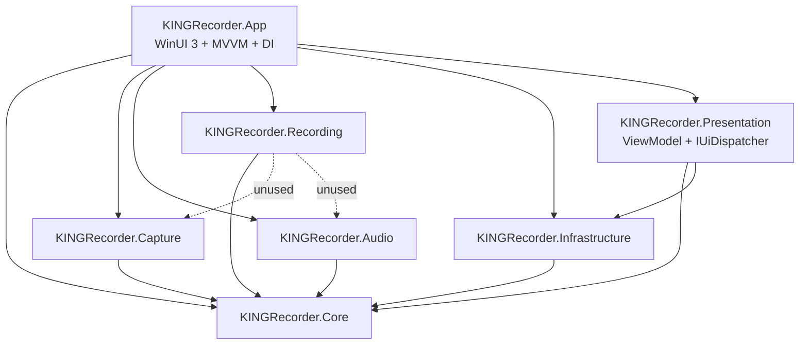
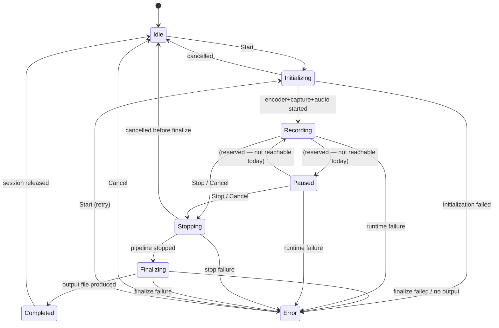
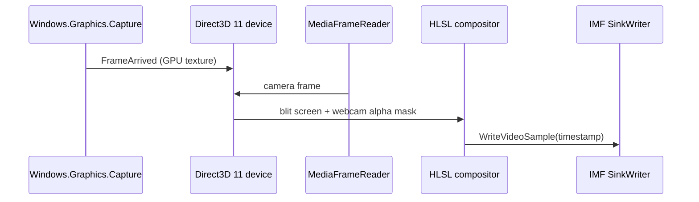

# KING RECORDER — Architecture

**Status of this document:** describes what exists in the code today, and labels every target capability that does
not exist yet. Sections 5 and 6 are *target design*, not shipped behaviour.

- Target stack: C# 13 / .NET 10 (`net10.0-windows10.0.19041.0`), WinUI 3 + Windows App SDK 1.5, Direct3D 11, x64.
- Product identity: KING RECORDER 1.0.0 MVP, Premium KING palette (charcoal black `#0C0D10`, gold `#D4AF37`,
  recording red `#EF4444`).

---

## 1. Project layout and dependency direction

```text
KINGRecorder.App  (WinUI 3 shell, DispatcherQueue adapter, composition root)
   ├── KINGRecorder.Presentation    (MainViewModel, IUiDispatcher; no WinUI reference — unit tested)
   ├── KINGRecorder.Core            (domain: models, enums, interfaces, exceptions, state table) — no dependencies
   ├── KINGRecorder.Capture         (Win32 enumeration today; Windows.Graphics.Capture in Phase 1)
   ├── KINGRecorder.Audio           (device enumeration today; WASAPI in Phase 3)
   ├── KINGRecorder.Recording       (session lifecycle engine today; MF encoder in Phase 4)
   └── KINGRecorder.Infrastructure  (settings persistence)
```

Dependency rule: every product project may reference `Core`; `Core` references nothing. `Recording` also references
`Capture` and `Audio` but consumes only `Core` abstractions (the project references are currently unnecessary and are
kept only to avoid churn).



---

## 2. Composition root and service lifetimes

Registration lives next to each implementation so it can be unit tested without the WinUI host:

| Extension | Location | Registrations |
|---|---|---|
| `AddKingRecorderInfrastructure()` | `src/KINGRecorder.Infrastructure/InfrastructureServiceCollectionExtensions.cs` | `SettingsManager` → singleton |
| `AddKingRecorderCapture()` | `src/KINGRecorder.Capture/CaptureServiceCollectionExtensions.cs` | `Direct3D11CaptureEngine` singleton + `IScreenCaptureService` resolved from that same instance |
| `AddKingRecorderAudio()` | `src/KINGRecorder.Audio/AudioServiceCollectionExtensions.cs` | `WasapiAudioCaptureService` singleton + `IAudioCaptureService` from the same instance |
| `AddKingRecorderRecording()` | `src/KINGRecorder.Recording/RecordingServiceCollectionExtensions.cs` | `IVideoCompositor` → `UnavailableVideoCompositor`, `IEncoderService` → `UnavailableEncoderService`, `RecordingEngine` singleton + `IRecordingEngine` from the same instance |

All registrations use `TryAdd`, so a host or a test can substitute an implementation without duplicate registration.

`Program.Main` builds the provider with `ValidateOnBuild = true` and `ValidateScopes = true`, so a misconfigured
graph fails at startup instead of at first use, and disposes the provider in a `finally` block when `Application.Start`
returns.

### Ownership and disposal rules

1. **The DI container owns every disposable service.** `RecordingEngine` collaborates with capture/audio/compositor/
   encoder but never disposes them.
2. `RecordingEngine` releases only its own state: `ShutdownAsync()` waits for an in-flight lifecycle operation,
   aborts the started pipeline stages, deletes the incomplete output, resets the stopwatch and clears its event
   handlers. `Dispose()` is the bounded synchronous fallback for callers that cannot await (5 s per gate, then it
   logs and defers). Both are idempotent and neither disposes capture/audio/compositor/encoder.
3. `Program.Main` awaits `IRecordingEngine.ShutdownAsync()` in a `finally` block **before** disposing the service
   provider, so no container-owned service is released while the engine still uses it.
4. `MainViewModel` is transient, marshals engine notifications through `IUiDispatcher`, and unsubscribes exactly
   once in `Dispose`, which `App.OnLaunched` hooks to `Window.Closed`.
5. Unavailable capabilities are registered as explicit throwing stubs, never as silent no-ops and never as fake
   producers of output.

---

## 3. Recording session state machine

The authoritative table is `src/KINGRecorder.Core/State/RecordingStateTransitions.cs`; the engine validates every
transition through it and the unit tests assert the table directly.



Guarantees implemented in Phase 0.2:

- **Validated transitions only.** Anything outside the table throws `InvalidOperationException` from
  `EnsureTransition`, so an illegal sequence cannot be represented.
- **Serialized lifecycle.** A `SemaphoreSlim` gate serializes `Start`/`Stop`/`Cancel`; concurrent `Start` calls
  cannot both begin a session, and a second `Stop` cannot double-finalize.
- **Recovery.** A failed session lands in `Error`, which has explicit exits to `Idle` (cancel) and `Initializing`
  (retry). Failures never permanently lock the engine.
- **Partial initialization cleanup.** Each pipeline stage is tracked (`_encoderStarted`, `_captureStarted`,
  `_audioStarted`); on failure or cancellation only the started stages are stopped, and only once.
- **Cancellation.** A cancelled token rethrows `OperationCanceledException` unchanged, cleans up partial state and
  returns the engine to `Idle`.
- **Error fidelity.** The original exception type, message, stack trace and inner exception are preserved (`throw;`,
  no blanket rewrapping).
- **Honest pause.** `PauseRecordingAsync` throws `NotSupportedException` while `Recording` and keeps recording,
  because no capture/encode pipeline exists to suspend. `Paused` remains defined for the future pipeline.
- **Isolated notifications (Phase 0.2.1).** The transition is committed before any subscriber runs; each subscriber
  is invoked inside its own `try`/`catch`, and failures are logged with the transition and the subscriber type. A
  subscriber can neither abort a transition, skip later subscribers, nor replace the recording exception.
- **Coordinated shutdown (Phase 0.2.1).** `ShutdownAsync` takes both gates, aborts the session, removes its
  incomplete file and refuses further operations; the state then moves to `Idle` when the table allows it, otherwise
  to `Error` with the shutdown reason.
- **No incomplete output.** Failed or cancelled initialization deletes the file the encoder had already opened.

`DurationUpdated` is raised once with the final duration on a successful stop. Periodic ticking requires the real
capture clock and arrives with Phase 1.

### UI dispatch path (Phase 0.2.1)

```text
RecordingEngine (any thread)
   └── StateChanged / DurationUpdated
          └── MainViewModel handler          (never touches bindings)
                 └── IUiDispatcher.TryEnqueue(...)        Presentation: no WinUI types
                        └── DispatcherQueueUiDispatcher   App: DispatcherQueue.TryEnqueue
                               └── queued callback: re-checks IsDisposed, then sets observable properties
```

- `Core`, `Recording` and `Presentation` contain no WinUI reference, which is what lets
  `KINGRecorder.Presentation.Tests` drive the ViewModel with a deterministic fake dispatcher and no XAML host.
- Notifications are always queued, never applied inline, so the UI observes the engine's raise order exactly.
- A rejected enqueue (`false`, dispatcher shutting down) is logged and dropped; a throwing dispatcher is caught and
  logged, so it cannot reach the engine's thread.
- `Dispose` is guarded by `Interlocked.Exchange` and every queued callback re-checks the flag, so work queued before
  shutdown cannot reach a closed window.

---

## 4. Implemented native surface (Win32 interop, verified by tests)

`Direct3D11CaptureEngine` contains real, unit-tested P/Invoke definitions:

| Struct / API | Verified property |
|---|---|
| `MONITORINFOEX` | 104 bytes; offsets `cbSize` 0, `rcMonitor` 4, `rcWork` 20, `dwFlags` 36, `szDevice` 40 |
| `DEVMODE` | 220 bytes; explicit offsets (`dmDeviceName` 0 … `dmDisplayFrequency` 184) |
| `RECT` | 16 bytes; offsets 0/4/8/12 |
| `EnumDisplayMonitors` + `GetMonitorInfo` | Monitor enumeration with cancellation |
| `EnumDisplaySettings` + `DM_DISPLAYFREQUENCY` | Real refresh rate, `0` when unknown |
| `shcore!GetDpiForMonitor` / `user32!GetDpiForSystem` | Effective DPI scale, `1.0` fallback, unit tested |
| `EnumWindows` + `DWMWA_CLOAKED` (4-byte BOOL) | Visible, titled, non-cloaked windows |
| `GetWindowThreadProcessId` | Process name, access-denied tolerated |

`SettingsManager` persists `RecordingOptions` as JSON under `%LOCALAPPDATA%\KINGRecorder\settings.json` using a
temporary file plus `File.Replace`, validates volume ranges (including NaN/Infinity) and defaults the output
directory to `%USERPROFILE%\Videos\KING Recorder`.

---

## 5. Target capture and composition pipeline (NOT IMPLEMENTED — Phase 1/2)



Today `Direct3D11CaptureEngine.StartCaptureAsync` throws `NotSupportedException` and keeps `IsCapturing = false`;
`UnavailableVideoCompositor.Initialize/Composite` throw as well. `IWebcamService` has no implementation and is not
registered.

## 6. Target audio pipeline (NOT IMPLEMENTED — Phase 3)

WASAPI loopback (`AUDCLNT_STREAMFLAGS_LOOPBACK`) plus microphone, silence injection when playback is idle, and a
48 kHz stereo mixer with soft limiter damping. Today `WasapiAudioCaptureService.StartAsync` throws
`NotSupportedException`; only device enumeration works. The limiter formula referenced in the docs is validated only
as arithmetic inside a test — no production mixer exists.

## 7. Target encoder (NOT IMPLEMENTED — Phase 4)

`IMFSinkWriter` with H.264 video and AAC audio, hardware MFT selection (NVENC/QSV/AMF) with software fallback. Today
`UnavailableEncoderService` throws on every member.

## 8. Known architectural risks

| Risk | Impact | Mitigation |
|---|---|---|
| `TreatWarningsAsErrors` + events never raised (`FrameArrived`, `AudioDataAvailable`) | CS0067 would fail the build | Both declarations carry a one-line `CS0067` pragma naming the Phase 1/3 delivery that will raise them; remove the pragma at that point |
| `Recording` references `Capture`/`Audio` without using them | Coupling | Remove when the pipeline lands |
| SharpDX 4.2.0 is maintenance-only | Long-term | Planned migration to Vortice.Windows/CsWin32, not part of Phase 0.2 |
| No `<Platforms>`/`RuntimeIdentifier` declared | `AnyCPU` fallback surprises | Always pass `-p:Platform=x64`; revisit when packaging is designed |
| Composition root still lives in the WinUI project's `Program.cs` | Layer registrations and the ViewModel are unit tested; the final graph wiring is not | `ValidateOnBuild` fails startup on a broken graph; extract a UI-agnostic host when the app gains a second host |
| The real `DispatcherQueue` adapter is only exercised by a fake | A genuine queue-shutdown path is not covered automatically | Manual desktop check before the dashboard is called done; the adapter is ~15 lines with no logic beyond `TryEnqueue` |
| Synchronous `Dispose()` defers cleanup when an operation outlives 5 s | A foreign caller could exit without stopping the pipeline | The application always awaits `ShutdownAsync()`; the bound and the deferral are documented on the method |
| A failed `StopRecordingAsync` keeps its partially written file | A corrupt file can remain after a stop failure | Phase 0.2.1 covers failed/cancelled *initialization* only; extend `DeleteIncompleteOutput` to the stop-failure path together with the encoder work |
