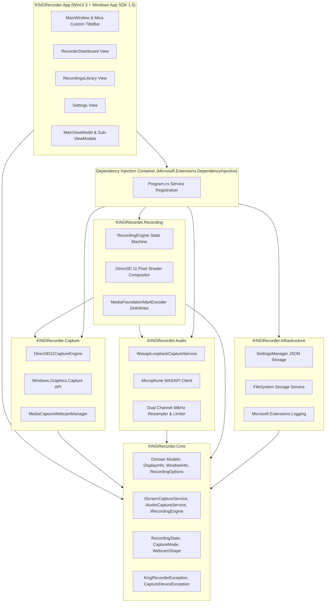
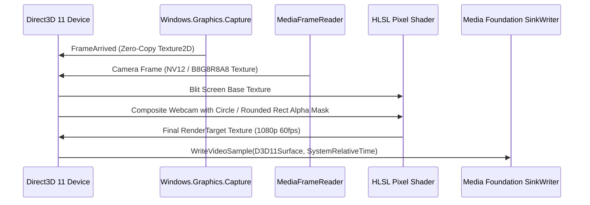

# KING RECORDER — Native Architecture Specification

## 1. High-Level Architectural Diagram

---

## 2. Project Responsibilities & Dependency Boundaries

1. **`KINGRecorder.Core`**:
   - Zero project dependencies.
   - Contains immutable domain records, state contracts, and service abstractions.
   - Any layer can reference `Core`, but `Core` never references outer layers.

2. **`KINGRecorder.Capture`**:
   - Implements `IScreenCaptureService` and `IWebcamService`.
   - Direct integration with `Windows.Graphics.Capture`, `Direct3D11CaptureFramePool`, and `Windows.Media.Capture`.
   - Translates raw native frame arrivals into managed `FrameArrivedEventArgs`.

3. **`KINGRecorder.Audio`**:
   - Implements `IAudioCaptureService`.
   - Bridges WASAPI loopback (`AUDCLNT_STREAMFLAGS_LOOPBACK`) and microphone inputs.
   - Manages audio packet buffers, volume scaling, and 48kHz audio resamplers.

4. **`KINGRecorder.Recording`**:
   - Authoritative state machine: orchestrates capture, composition, and encoding.
   - Manages the high-resolution monotonic clock (`QueryPerformanceCounter`) to synchronize frames and audio.
   - Enforces pause/resume timestamp offset tracking.
   - Muxes streams through Windows Media Foundation `IMFSinkWriter`.

5. **`KINGRecorder.Infrastructure`**:
   - Local JSON settings persistence in `%LOCALAPPDATA%\KINGRecorder\settings.json`.
   - Recording file management in `%USERPROFILE%\Videos\KING Recorder\`.
   - Structured logging output.

6. **`KINGRecorder.App`**:
   - Visual presentation layer built with WinUI 3 and XAML.
   - MVVM architecture with `CommunityToolkit.Mvvm`.
   - Wires dependency injection in `Program.cs`.
   - Bilingual localization with dynamic RTL support for Arabic.

---

## 3. Capture & Composition Pipeline (GPU Accelerated)

---

## 4. Audio Pipeline & Monotonic Synchronization

1. **WASAPI Loopback Capture**:
   - Captures system master mix at floating-point 32-bit PCM.
   - If audio output is idle, a silence injector emits blank packets so the audio timeline never stalls.
2. **Microphone Capture**:
   - Captured via event-driven low-latency WASAPI buffer.
3. **Clipping Prevention & Limiter**:
   - Software gain is calculated as:
     $$\text{Damping} = \begin{cases} 1.0 & \text{if } M + S \le 1.0 \\ \frac{1.0}{\sqrt{M + S}} & \text{if } M + S > 1.0 \end{cases}$$
   - Applied per sample to eliminate digital clipping.
4. **Encoding**:
   - Mixed stream encoded to AAC 192 kbps, 48,000 Hz, 2 channels.
